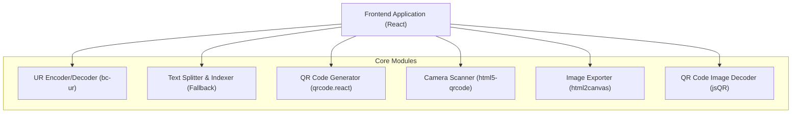

## 1. 架构设计


## 2. 技术栈说明
- **Frontend**: React@18 + tailwindcss@3 + vite
- **State Management**: Zustand
- **Routing**: React Router v6
- **QR Code Generation**: `qrcode.react`
- **Fountain Code / UR**: `@ngraveio/bc-ur` (基于 LT 码的动态传输协议)
- **Camera Scanning**: `html5-qrcode` (实时视频流二维码识别)
- **Image Export (Fallback)**: `html2canvas`
- **Image Decoding (Fallback)**: `jsQR`

## 3. 路由定义
| 路由 | 用途 |
|-------|---------|
| `/` | 默认生成端（Sender）：输入文本、UR编码轮播播放（主）、静态长图导出（兜底） |
| `/receiver` | 解析端（Receiver）：摄像头实时扫描 UR 分片（主）、长图上传解析（兜底） |

## 4. 核心数据结构 (Zustand Store)
```typescript
interface AppState {
  // Common Sender
  sourceText: string;
  setSourceText: (text: string) => void;
  
  // Animated Sender (UR Protocol)
  urEncoder: UREncoder | null;
  currentURFragment: string;
  isAnimating: boolean;
  initUREncoder: () => void;
  setAnimating: (isAnimating: boolean) => void;
  nextFragment: () => void;
  
  // Static Sender (Fallback)
  chunkSize: number;
  qrChunks: QRCodeChunk[];
  setChunkSize: (size: number) => void;
  generateStaticChunks: () => void;
  
  // Animated Receiver (UR Protocol)
  urDecoder: URDecoder | null;
  urProgress: number; // 0-1
  decodedText: string | null;
  initURDecoder: () => void;
  receiveURFragment: (fragment: string) => void;
  
  // Static Receiver (Fallback)
  staticDecodedChunks: DecodedChunk[];
  addStaticDecodedChunk: (chunk: QRCodeChunk) => void;
  getStaticCompleteText: () => string;
}
```

## 5. 关键技术方案
1. **喷泉码传输 (UR 协议)**:
   使用 `@ngraveio/bc-ur` 库将大文本转换为 UR (Uniform Resource) 对象。编码端以固定的时间间隔（如 `requestAnimationFrame` 配合节流，或 `setInterval` 实现 10 FPS）不断提取下一个 `part` 并渲染为二维码。
   接收端通过 `html5-qrcode` 从摄像头捕获数据，并将其送入 `URDecoder.receivePart()`。解码器会自动处理丢帧和乱序，直至 `URDecoder.isComplete()` 返回 true。
2. **文本编码**:
   **注意**：无论是 UR 协议还是静态切分，中文字符的处理必须在转为 Buffer 时使用 `TextEncoder('utf-8')`，确保接收端还原为 Buffer 时也能通过 `TextDecoder('utf-8')` 正确解码出中文。
3. **静态长图 (兜底)**:
   作为后备方案保留，适用于设备无摄像头或环境不适合扫描的场景。