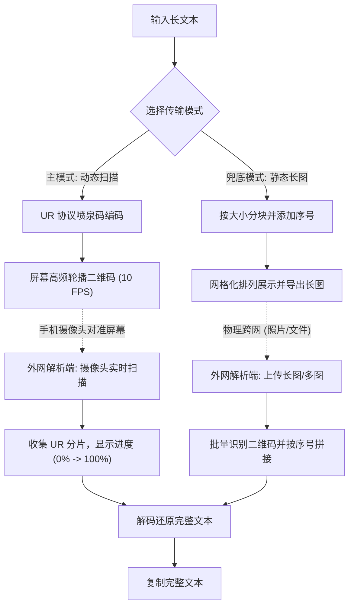

## 1. 产品概述
用于隔离内网向外网单向传输文本数据的纯前端 Web 工具。
- 解决内网与外网物理隔离、无法复制粘贴且单向文件传输大小受限（<50M）的问题。
- 通过“内网生成分块二维码长图 -> 外网扫码/图片解析”的方式，实现长文本的无损跨网传输。

## 2. 核心功能

### 2.1 核心模块
1. **生成端 (Sender)**: 长文本输入、基于喷泉码（UR 协议）的动态二维码生成与高频轮播播放（主方案）；网格排列与长图导出（兜底方案）。
2. **解析端 (Receiver)**: 摄像头实时连续扫描与解码进度跟踪、自动还原大文本（主方案）；多图上传/长图上传批量解析（兜底方案）。

### 2.2 页面详细说明
| 页面名称 | 模块名称 | 功能描述 |
|-----------|-------------|---------------------|
| 生成端页面 | 文本输入区 | 允许用户粘贴或输入超长文本，显示字符统计。 |
| 生成端页面 | 动态播发区 | （主功能）将文本编码为 UR 喷泉码流，在屏幕中央以设定帧率（如 10FPS）快速轮播二维码。 |
| 生成端页面 | 静态导出区 | （兜底功能）将文本按设定容量分块并生成带序号的二维码网格，提供“导出为长图”功能。 |
| 解析端页面 | 摄像头扫描区 | （主功能）调用设备摄像头，对准动态二维码屏幕，实时收集分片并显示进度百分比，满 100% 后自动解析。 |
| 解析端页面 | 图片上传区 | （兜底功能）支持上传单张长图或多张静态二维码图片进行解析。 |
| 解析端页面 | 结果展示区 | 展示完整拼接文本，并提供一键复制功能。 |

## 3. 核心流程
**主流程（动态喷泉码传输）**：
用户在内网环境输入长文本，系统基于 UR 协议将其编码为喷泉码流并开始在屏幕上高速循环播放二维码。外网设备（如手机）访问解析端，打开摄像头对准内网屏幕，页面实时显示收集进度，无需关心丢帧问题，收集率达到阈值后瞬间还原并显示完整文本。

**兜底流程（静态长图传输）**：
如果由于设备问题无法实时扫描，用户可切换至静态模式，生成长图保存，然后通过特殊通道或拍照片后，在外网解析端上传图片识别并拼接。

## 4. 用户界面设计
### 4.1 设计风格
- **整体基调**: 工业风、极简实用主义 (Utilitarian)，以高效完成任务为核心。
- **色彩规范**: 
  - 主色调：黑白灰，辅以科技蓝 (`#2563EB`) 或效率绿 (`#16A34A`) 作为操作强调色。
  - 背景色：深色模式为主，减少大面积白色屏幕光晕对手机拍照扫码的干扰。二维码底色保持纯白以确保对比度。
- **排版布局**: 卡片式布局，左右分栏或上下结构。二维码区域需有明显的边界和序号标识。
- **交互细节**: 生成进度提示、解析成功/失败的反馈动画、骨架屏加载状态。

### 4.2 页面设计概览
| 页面名称 | 模块名称 | UI 元素及样式 |
|-----------|-------------|-------------|
| 首页 (生成端) | 文本输入 | 全屏或半屏的宽大文本框，等宽字体，悬浮操作栏 |
| 首页 (生成端) | 二维码网格 | 白底黑码，每个二维码下方带有清晰的 `[索引/总数]` 标签，一行 5-6 个 |
| 解析端 | 上传区域 | 巨大的虚线拖拽上传框，带有相机和图片图标 |
| 解析端 | 结果展示 | 仿代码编辑器的文本框，带有“一键复制”悬浮按钮 |

### 4.3 响应式要求
优先适配桌面端（Desktop-first），解析端需兼顾移动端适配（Mobile-adaptive），方便手机直接拍照解析。